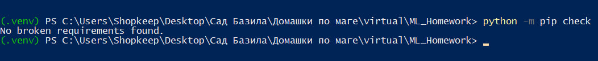
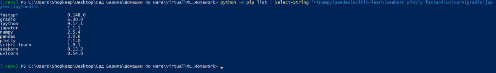
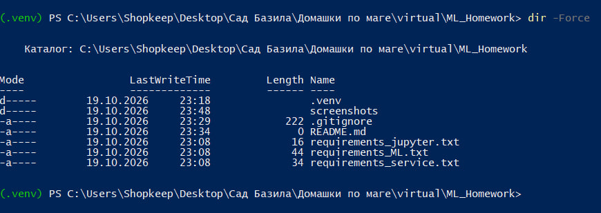

Виртуальное окружение Python

Цель работы

Научиться создавать виртуальное окружение Python, управлять зависимостями и подготавливать воспроизводимую среду для проектов машинного обучения.

1. Создание виртуального окружения

Для выполнения работы была создана папка проекта `ML_Homework`.

Команды для создания окружения в PowerShell:

1. `mkdir ML_Homework` — создание папки проекта.
2. `cd ML_Homework` — переход в папку проекта.
3. `py -m venv .venv` — создание виртуального окружения.
4. `.\.venv\Scripts\Activate.ps1` — активация окружения.

При успешной активации в начале строки терминала появляется `(.venv)`.

2. Управление зависимостями

Для разделения библиотек по назначению были созданы три файла:

requirements_ML.txt

- numpy
- pandas
- scikit-learn
- seaborn
- plotly

requirements_service.txt

- fastapi
- uvicorn[standard]
- gradio

requirements_jupyter.txt

- jupyter
- ipython

Для установки зависимостей используются команды:

- `python -m pip install -r requirements_ML.txt`
- `python -m pip install -r requirements_service.txt`
- `python -m pip install -r requirements_jupyter.txt`

Все зависимости устанавливаются в активное виртуальное окружение.

3. Проверка установленных пакетов

Для проверки зависимостей была выполнена команда:

`python -m pip check`

Результат:

`No broken requirements found.`

Это означает, что pip не обнаружил нарушенных зависимостей в окружении.

4. Возникшие трудности

При попытке активировать виртуальное окружение в PowerShell возникла ошибка `PSSecurityException`.

Причиной стала политика безопасности Windows, ограничивающая запуск PowerShell-скриптов.

Проблема была решена следующей командой:

`Set-ExecutionPolicy -Scope Process -ExecutionPolicy RemoteSigned`

После выполнения команды повторная активация окружения прошла успешно.

Параметр `Scope Process` позволяет изменить политику только для текущего сеанса PowerShell.

5. Использование Git

Для исключения ненужных файлов из репозитория создан `.gitignore`.

В него добавлены виртуальное окружение `.venv/`, кэш Python, временные файлы Jupyter и `.env`.

Это позволяет не загружать установленные библиотеки в репозиторий. Их можно восстановить из файлов requirements.

6. Скриншоты выполнения

Проверка зависимостей

После установки библиотек была выполнена
проверка зависимостей командой
`python -m pip check`.

Установленные библиотеки

Проверка версий установленных библиотек
с помощью команды `python -m pip list`.

Структура проекта

Проверка созданных файлов и папок
с помощью команды `dir -Force`.

## Вывод

В ходе работы было создано виртуальное окружение Python, подготовлены файлы зависимостей и проверена корректность их установки.

Получены практические навыки работы с venv, pip и файлами requirements. Подготовлен проект, который можно использовать для дальнейших заданий по машинному обучению.